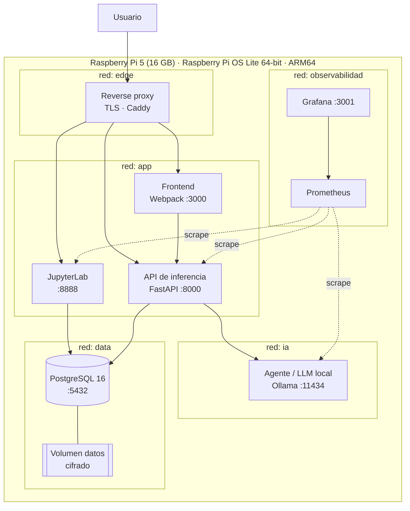

# Arquitectura

## 1. Diagrama de la topología

## 2. Capas

| Capa | Componente | Función |
|---|---|---|
| Sistema | Raspberry Pi OS Lite 64-bit | Base endurecida, cgroups v2 |
| Orquestación | Docker Compose / Podman Compose | Ciclo de vida de los contenedores |
| Datos | PostgreSQL + volumen cifrado | Persistencia y trazabilidad |
| Ciencia de datos | JupyterLab | Exploración, preprocesamiento, entrenamiento |
| Servicio | FastAPI | Inferencia del modelo en producción |
| Agentes | Ollama | LLM local para agentes inteligentes |
| Presentación | Frontend Webpack | Interfaz de usuario |
| Observabilidad | Prometheus + Grafana | Métricas, alertas y auditoría |

## 3. Flujo de datos

1. Los datos crudos se depositan en el volumen cifrado y se documentan en `config/`.
2. Se **anonimizan** antes de cualquier automatización (anexo de ética, punto 2).
3. `pipelines/` ejecuta el preprocesamiento e ingeniería de características.
4. `notebooks/` se usa para exploración y evaluación; `src/` recibe el código validado.
5. El modelo entrenado se guarda en `models/` con sus hiperparámetros.
6. La API lo carga y sirve predicciones; `monitoring/` vigila deriva y rendimiento.

## 4. Aislamiento de red

Cada grupo de servicios vive en su propia red; **ningún** contenedor ve al resto salvo
por el proxy. Esto reduce la superficie de ataque y limita el movimiento lateral si un
servicio se compromete — ver [seguridad.md](seguridad.md#3-endurecimiento-de-contenedores).
